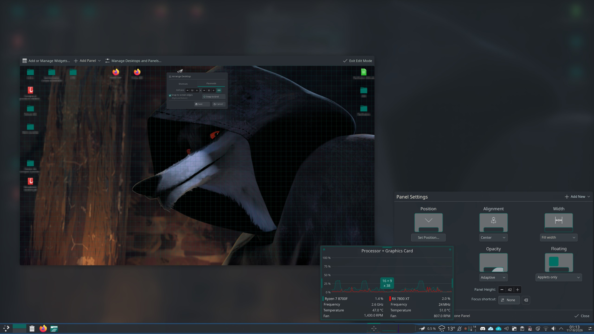
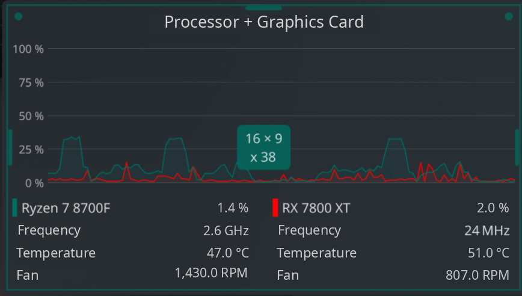

# pannel-arrange

*Made for myself with AI, offered to anyone who finds it useful.*

Resize and place the popups of the KDE Plasma panel widgets on a grid.

It works with or without [plasma-arrange](https://github.com/ClarkBoggle/plasma-arrange):

- **With plasma-arrange**: sizes and positions snap to its **plasmoid grid**, the
  one of the desktop shown on the screen of the popup, and are shown in cells.
- **Without it**: they use the **screen coordinates**, in pixels, without
  snapping.

In edit mode, open the configuration of a panel (click on it), then click on
one of its widgets: its popup opens, framed, with resize handles.

- **Resize**: drag the handles on its free edges and corners (not on the edge
  against the panel). The size snaps to whole cells of the grid.
- **Move**: drag anywhere else in the popup. It moves along the panel only,
  snapped to the cells counted from the start of the panel; it always stays
  against the panel. A double click puts it back centered on its widget.
- In the middle, the popup shows its **size** and its **position** along the
  panel, in cells (`16 × 9`, `x 38`; in pixels without plasma-arrange): give
  several popups the same position to open them at the same place.
- A second click on the widget closes its popup. Widgets without a popup (shown
  in full in the panel, or with an empty one) show their usual menu.

Outside edit mode, popups open with their size and at their position. Plasma
saves the size of each popup; the positions are saved in the panel
configuration.

The panel configuration open, the popup of a CPU monitor widget opened over it:
16 × 9 cells, moved to 38 cells from the start of the panel. The desktop shows
the grid of plasma-arrange.

[](https://github.com/ClarkBoggle/pannel-arrange/blob/assets/desktop-popup.jpg?raw=true)

The popup in edit mode: its frame, the resize handles on its free edges and
corners (not on the edge against the panel), its size and position in the
middle.



## Your system is not modified

- Plasma's panel is built into a plugin (`org.kde.panel.so`): pannel-arrange is a
  **copy of its source** (`containments/panel` of plasma-desktop, at the tag of
  the installed Plasma version), with the popup resizing added to it.
- **Everything is installed in your home folder**:
  - the panel, in `~/.local/share/plasma/plasmoids/org.kde.panel`. Plasma uses
    it instead of the one of its plugin, for your user only;
  - a copy of Plasma's panel translations, in
    `~/.local/share/locale/<language>/LC_MESSAGES/plasma_applet_pannel-arrange.mo`
    (the copy of the panel looks for them under this name).
- **Nothing is changed in the system**: no file outside your home folder is
  written, the plugin stays untouched, no root rights are needed (never run the
  scripts with `sudo`).
- To go back to the original panel, `./uninstall.sh` removes both: Plasma uses
  its own panel again.

## Requirements

- KDE Plasma 6.8 (made and tested with 6.8.2, on Wayland)
- `git` and a network connection after a Plasma update (to fetch the panel
  source of the new version)
- Plasma started by systemd (`plasma-plasmashell` user service, the default)
- Optional: [plasma-arrange](https://github.com/ClarkBoggle/plasma-arrange), for
  the grid

## Installation

```sh
git clone https://github.com/ClarkBoggle/pannel-arrange.git
cd pannel-arrange
./install.sh
```

Clone with git as above (not a ZIP download, which `install.sh` refuses): the
updates for new Plasma versions are made with git, in the clone.

`install.sh` copies `package/` to `~/.local/share/plasma/plasmoids/org.kde.panel`,
copies the panel translations and reloads the desktop. Nothing is changed outside
your home folder.

Run `./install.sh` again after any change to `package/`.

## Uninstallation

```sh
./uninstall.sh
```

Removes the installed copy and the translations, and reloads the desktop: Plasma
uses its own panel again. Popup sizes and positions stay in the Plasma
configuration.

`install.sh` and `uninstall.sh` leave alone any other copy of the panel package
found in `~/.local/share/plasma/plasmoids/` (they recognize theirs by
`contents/ui/PopupResize.qml`).

## After a Plasma update

Since the panel is a modified copy of Plasma's, it must follow Plasma's updates.
After updating Plasma, from the cloned repository:

```sh
./install.sh
```

Seeing a new Plasma version, it runs `./update-plasma.sh` first (which can also
be run directly): it fetches the panel source of the new version, applies the
popup resizing to it again and reinstalls. If the changes conflict with the new
version, it removes the installed copy and stops: Plasma uses its own panel
until pannel-arrange is updated for that version.

## Files

`package/` is a copy of `containments/panel` of plasma-desktop 6.8.2 (tag
`v6.8.2`), laid out as a package: the `.qml` and `.js` files in
`contents/ui/`, `main.xml` in `contents/config/`. Compared to it:

**Added**

| File | Role |
|---|---|
| `package/contents/ui/PopupResize.qml` | Opens the popup of a clicked widget in edit mode, puts the handles in it, finds the grid of plasma-arrange |
| `package/contents/ui/PopupHandles.qml` | In the popup: resize handles, move by a drag, size and position shown in the middle |
| `package/contents/ui/PopupPlacement.qml` | Places the moved popups along the panel (always, not only in edit mode), keeps their size |
| `package/contents/ui/PopupMath.js` | Computations (snapping, dragged edges) |
| `install.sh`, `uninstall.sh` | Installation, uninstallation |
| `update-plasma.sh` | Update after a Plasma update (called by `install.sh`) |

**Modified**

| File | Change |
|---|---|
| `package/contents/ui/main.qml` | 8 lines added, 1 line of Plasma changed, marked *Popup resizing*: see [Changes to main.qml](#changes-to-mainqml) |
| `package/contents/ui/ConfigOverlay.qml` | 10 lines added, 1 line of Plasma changed, marked *Popup resizing*: see [Changes to ConfigOverlay.qml](#changes-to-configoverlayqml) |
| `package/contents/config/main.xml` | The `PopupOffsets` setting: positions of the moved popups |
| `package/metadata.json` | 3 lines: see [Changes to metadata.json](#changes-to-metadatajson) |

All the other files of `package/` are Plasma's, unchanged.

## Changes to main.qml

`main.qml` is the main file of Plasma's panel. It is kept as close to the
original as possible: all the logic is in the added files. These lines must be
carried over when a Plasma update changes it (`update-plasma.sh` does it).

In total: 8 lines added (1 of them a comment, 1 empty), 1 line of Plasma changed
(a comma added). Line numbers are those of the modified file.

**1. The panel configuration gets the popup placement** (line 147)

The widget menu of the panel configuration (`ConfigOverlay.qml`) is created
here; it is given `PopupPlacement`, to move the popups.

```diff
             "lastSpacer": lastSpacer,
-            "addWidgetsButton": addWidgetsButton
+            "addWidgetsButton": addWidgetsButton,
+            "popupPlacement": popupPlacement // Popup resizing
         });
```

**2. The `PopupPlacement` instance** (line 154)

Always there, not only in edit mode: the moved popups must open at their
position.

```diff
+    // Popup resizing: popups placed by the user along the panel
+    PopupPlacement {
+        id: popupPlacement
+        appletsModel: appletsModel
+        horizontal: root.isHorizontal
+    }
```

## Changes to ConfigOverlay.qml

`ConfigOverlay.qml` only exists while the panel configuration is open: it lets
widgets be moved in the panel, and shows the menu of a clicked widget (*Remove*,
*Configure…*, *Show Alternatives…*).

In total: 10 lines added (3 of them comments, 1 empty), 1 line of Plasma
changed. Line numbers are those of the modified file.

**1. The popup placement, given by main.qml** (line 36)

```diff
     required property int rootWidth
+    required property PopupPlacement popupPlacement // Popup resizing (main.qml)
```

**2. A click opens the popup** (line 173)

A click on a widget (not a drag, which still moves it in the panel) opens or
closes its popup. When the widget has no popup, the menu shows as before.

```diff
         if (configurationArea.dragAndDropping) {
             finishDragOperation();
+        } else if (popupResize.toggle(configurationArea.currentApplet)) {
+            // Popup resizing: the click opened or closed the widget popup
         } else {
             tooltip.openedByTap = true;
```

**3. The `PopupResize` instance** (line 218)

```diff
+    // Popup resizing: a click opens the widget popup, resized on the grid
+    PopupResize {
+        id: popupResize
+        placement: configurationArea.popupPlacement
+    }
```

**4. No menu over an open popup** (line 296)

The menu shows when the mouse is over a widget; not while a popup is open,
which it would cover.

```diff
-        visible: configurationArea.currentApplet && !configurationArea.dragAndDropping && !showTimer.running
+        // Popup resizing: hidden while a widget popup is open
+        visible: configurationArea.currentApplet && !configurationArea.dragAndDropping && !showTimer.running && !popupResize.popupOpen
```

## Changes to metadata.json

With only the files, Plasma would keep using the panel built into its plugin:
it takes the QML of a plugin whenever one exists. `X-Plasma-RootPath` names a
plugin that does not exist, so Plasma loads the panel from these files.
`KPackageStructure` and `Id` make it a package with the same name as Plasma's
panel, so that existing panels use it.

```diff
 {
+    "KPackageStructure": "Plasma/Applet",
+    "X-Plasma-RootPath": "pannel-arrange",
     "KPlugin": {
```

```diff
         "Category": "",
+        "Id": "org.kde.panel",
         "License": "GPL-2.0+",
```

Plasma then looks for the panel translations under the name
`plasma_applet_pannel-arrange`: `install.sh` copies Plasma's under that name.

## Credits

Written with [Claude Code](https://claude.com/claude-code). He doin a work while my hooman gibs me scritches 🐶.

## License

GPL version 2 or later, the license of Plasma's panel containment, from which
the package is derived: see [LICENSE](LICENSE). One unchanged Plasma file
(`LayoutManager.js`) is under the LGPL version 2 or later, as its header says.
